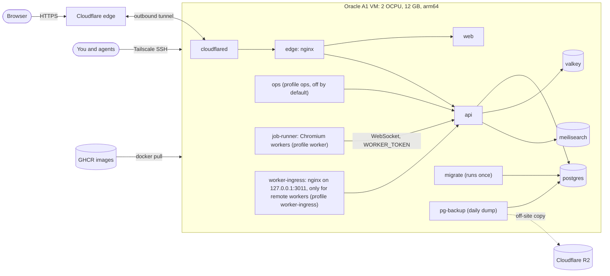
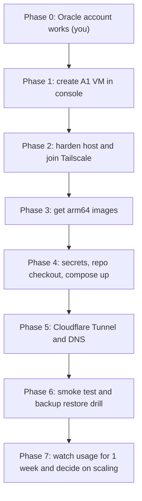
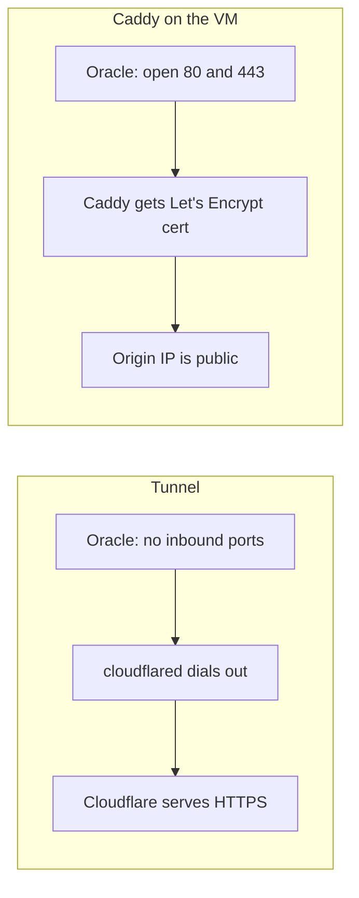
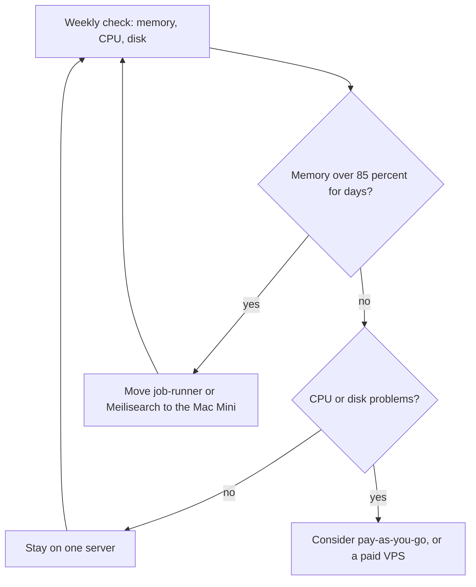

# Oracle Cloud deployment (single free server)

> **Status: PLANNED. Nothing is provisioned yet.** Last verified against the repo and Oracle's docs: 2026-10-31.
> Agent-readable short copy: [`oracle-deployment.agent.md`](oracle-deployment.agent.md). Update both together.
> Generic release pipeline and rollback rules live in [`deployment.md`](deployment.md); this page covers only the Oracle host.

## 1. What we decided

| Decision | Choice | Why | Date |
| --- | --- | --- | --- |
| Where to host | One Oracle Always Free Ampere A1 VM, full stack plus workers | See what one box can carry before paying or adding servers | 2026-10-31 |
| Second Oracle server | **No, not now** | The free allowance is one shared pool, so a second VM adds overhead, not capacity (section 2) | 2026-10-31 |
| Overflow plan | Move workers or Meilisearch to the Mac Mini first | It is already free and already ours | 2026-10-31 |
| Public ingress | Cloudflare Tunnel (leaning; pending final yes) | No inbound ports, free TLS, hidden origin IP (section 7) | 2026-10-31 |
| Backups | `pg-backup` on the box plus off-site copy to Cloudflare R2 | Carried over from the Mac Mini plan, which already verified R2 | 2026-10-13 |

## 2. Hard limits we are designing around

Oracle's [Always Free page](https://docs.oracle.com/en-us/iaas/Content/FreeTier/resourceref.htm) currently says:

- **Ampere A1 (arm64): 2 OCPUs and 12 GB RAM total**, as one VM or two VMs of 1 OCPU each. This was halved from 4 OCPUs and 24 GB on 2026-06-15 with no announcement ([InfoQ](https://www.infoq.com/news/2026/07/oracle-cloud-free-tier-limits/)). Whether pay-as-you-go accounts keep the old size is unconfirmed.
- **AMD micro:** up to two VMs with 1 GB RAM and a fraction of a core each. Too small for the main stack.
- **Storage:** 200 GB total across boot and block volumes. **Egress:** 10 TB per month.
- **Idle reclamation:** a VM is reclaimed if, over 7 days, CPU (95th percentile), network, and (on A1) memory are all under 20%. A busy stack should stay above this; check it after the first week.
- **Our own gap:** CI builds **amd64 images only**, and the A1 is **arm64**. See section 6, phase 3.

## 3. Topology

Service list is taken from `docker-compose.prod.yml`. `edge` is an allowlist for the **API only** (`/v1/`, `/webhooks/`, `/health`, `/telemetry/client-events`; everything else returns 404). It does not serve the website. The tunnel therefore needs two routes: the site hostname to `web` (port 3000) and an API hostname to `edge` (port 8080, host port 3001). `NEXT_PUBLIC_API_URL` is read at runtime by the server-rendered web app, so the public URL does not need to be baked into the image. `ops` (port 3002) must stay off the public tunnel and be reached over Tailscale.

## 4. Memory budget (estimates, not measurements)

| Item | Rough RAM | Note |
| --- | --- | --- |
| OS, Docker, Tailscale, cloudflared | 1 GB | |
| Postgres | 1 to 1.5 GB | tune `shared_buffers` low |
| Meilisearch | 2 to 3 GB | spikes while indexing |
| Valkey | 0.2 GB | |
| api, web, edge | 1.5 GB | |
| job-runner (Chromium) | up to 2 GB | `mem_limit: 2g` already set in compose |
| **Total** | **about 8 to 9.5 GB of 12 GB** | tight but plausible; add 2 to 4 GB swap |

Only `job-runner` has a memory limit today. We should add limits to the others so one service cannot starve the rest. Replace this table with measured numbers after the first week of running.

## 5. What tooling we already have

| Need | Use | Status |
| --- | --- | --- |
| Build, test, publish images | `.github/workflows/ci.yml` (GHCR, digest-pinned release manifest) | Exists, amd64 only |
| Roll out and roll back | `docker-compose.release.yml` from the `deploy-<sha>` GitHub Release | Exists |
| Server configuration | Ansible (installed locally; the Mac Mini repo has patterns to copy) | Exists |
| Private admin access | Tailscale (installed) | Exists |
| Secrets | **Undecided.** 1Password is being dropped. Apple Passwords has no official CLI or MCP. Options: `sops` + `age` encrypted file, or Vaultwarden on the Mac Mini with the `bw` CLI | None of `sops`, `age`, `bw` installed |
| GitHub, images | `gh` (installed) | Exists |
| Oracle API | `oci` CLI or OpenTofu | **Not installed.** No Oracle MCP server exists in the registry |
| Cloudflare tunnel and DNS | `cloudflared`, Cloudflare dashboard | **Not installed.** The Cloudflare MCP server covers Workers, KV and R2, not Tunnel or DNS |
| Backups and smoke tests | `docker/postgres-backup/backup.sh`, `scripts/restore-drill.sh`, `scripts/edge-smoke.sh` | Exist |
| Logs and metrics | Loki, Grafana, Prometheus, Alloy (dev `obs` profile) | Not in prod compose; prod logs currently go to a laptop |

Decision: create the VM once by hand in the Oracle console and write the exact settings into section 9. Adopt OpenTofu only if we ever need to rebuild it, because a single VM does not justify the extra tool yet.

## 6. Deploy process

| Phase | Steps | Done when |
| --- | --- | --- |
| 0. Account | Recover or recreate the Oracle account. Choose the home region (permanent). You enter the card yourself. | You can log in to the console |
| 1. VM | Ubuntu 24.04 arm64, `VM.Standard.A1.Flex`, 2 OCPU, 12 GB, boot volume about 100 GB, SSH key from your machine. If "out of capacity", retry later or try another availability domain. | `ssh` works |
| 2. Harden | SSH keys only, root login off, `unattended-upgrades`, host firewall (Oracle images ship with restrictive iptables), Tailscale, 2 to 4 GB swap. Keep the Oracle security list closed except what you decide. | Only Tailscale or SSH reachable |
| 3. Images | **Open decision.** CI must produce arm64 images. Options: (a) add QEMU and `platforms: linux/arm64` to the `docker` job, slow but simple; (b) a GitHub-hosted arm64 runner (this repo is public, and GitHub has offered these free for public repos; confirm current terms), the likely best choice; (c) a self-hosted runner on the Oracle box (`scripts/setup-runner.sh` exists), which competes for the 12 GB. Also confirm all five services plus Chromium run on arm64. | `docker pull` of each image on the VM runs |
| 4. Run | Install Docker. `docker login ghcr.io` with a read-only classic PAT. Check out the repo at the release commit (the compose file bind-mounts `./docker/...`). Build `.env` from the chosen secrets tool (section 5, undecided). `docker compose -f docker-compose.release.yml up -d` naming services explicitly, then the `worker` profile. | Healthchecks green |
| 5. Ingress | Create a named tunnel, route the hostname to the edge port, set `CORS_ORIGIN`, `NEXT_PUBLIC_API_URL`, `OPS_PUBLIC_ORIGIN` to the public URL. | Site loads over HTTPS |
| 6. Verify | Run `scripts/edge-smoke.sh`. Run a restore drill from an R2 copy. | Both pass |
| 7. Observe | Record CPU, memory, disk each day for a week; fill in section 4 with real numbers. | Scaling decision recorded in section 1 |

Known compose gotchas (from the 2026-10-13 plan, re-check before relying on them): compose interpolates every service, so ops-only variables must be set even when ops is off; always name services on the command line; `WORKER_TOKEN` must equal `WORKER_API_SECRET` (two older docs wrongly say `INTERNAL_API_SECRET`).

### Rollback

Re-run the previous `deploy-<sha>` manifest as described in [`deployment.md`](deployment.md). Migration ordering rules in that file apply unchanged. The tunnel and VM are not part of rollback; they do not change per release.

## 7. Why Cloudflare Tunnel (and why not)

**For:** closed firewall, automatic TLS, origin IP hidden, DDoS protection, works from any network (so the Mac Mini could host it later).
**Against:** Cloudflare becomes a single point of failure; it can read decrypted traffic; the domain's DNS must be on Cloudflare; one more component to debug.
Caddy is the fallback if we decide we do not want that dependency.

### Proposed hostnames (not created yet)

| Hostname | Goes to | Public? |
| --- | --- | --- |
| `wivwav.com` | `web` on port 3000 | Yes |
| `api.wivwav.com` | `edge` on port 8080 | Yes, API allowlist only |
| `ops` | `ops` on port 3002 | **No.** Reach it over Tailscale; no public hostname |
| `wav.vin` | Redirect to `wivwav.com` (role of this domain still to be decided) | Yes |

Set `CORS_ORIGIN` to the site origin, and `NEXT_PUBLIC_API_URL` to the API hostname.

## 8. Scaling decision

A second Oracle VM is not on this path: it splits the same 2 OCPU and 12 GB allowance.

## 9. Record of what was actually built

Fill in as each phase completes. Nothing here is true until it is written down.

> **This repository is public.** Never record secrets, the server's public IP, Tailscale names, tunnel IDs or account identifiers here. Keep those in private notes and write only "recorded privately" in this table.

| Item | Value |
| --- | --- |
| Oracle account / tenancy / region | _not created_ |
| VM shape, OCPU, RAM, boot volume | _not created_ |
| Public IP (if any), Tailscale name | _not created_ |
| Domains | `wivwav.com` and `wav.vin`, both owned and on Cloudflare DNS |
| Tunnel name and hostnames | _proposed in section 7, not created_ |
| Arm64 image approach | _undecided_ |
| First successful deploy (date, release sha) | _none_ |

## 10. Keeping this page true

Any change to the deployment must update this page and the agent copy **in the same commit**:

- `docker-compose.prod.yml`, `docker/**`, `scripts/release-manifest.sh`, the publish job in `.github/workflows/ci.yml`, or anything on the Oracle host.
- Enforced two ways: `scripts/check-docs.sh` blocks a commit that stages those files without this page, and `scripts/check-deploy-docs.sh` (part of `pnpm lint`) fails if a service in `docker-compose.prod.yml` is not named here.
- Add a line to the change log below for every change.

## Change log

| Date | Change |
| --- | --- |
| 2026-10-31 | Page created. Plan only. Free-tier limits re-verified (2 OCPU, 12 GB). |
| 2026-10-31 | Removed 1Password as the secrets source; secrets tool now undecided. |
